<p align="center"></p>

<p align="center"></p>

<p align="center">
  <a href="https://ahmedtarek.tech"></a>
  
  
  
  
  
  
  
  
  
  
  
  
  
  
  
  <a href="branding/BRAND.md"></a>
</p>

<p align="center"><b>A public portfolio, with a set of private, passkey-protected tools behind it:</b><br/>
client hours · daily planning · product triage · personal finance with an AI agent · a content and newsletter dashboard.</p>

> [!NOTE]
> **There is no build step.** The repository is what gets served: HTML, CSS and plain browser JavaScript, plus twelve Vercel serverless functions in [`api/`](api/). Clone it, serve the folder, and you have the site. 🎉

### 👀 Take a look

<table>
  <tr>
    <td width="50%">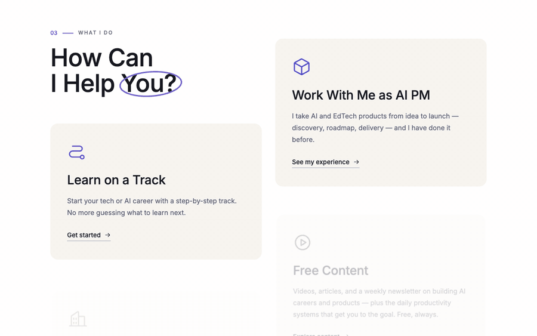</td>
    <td width="50%">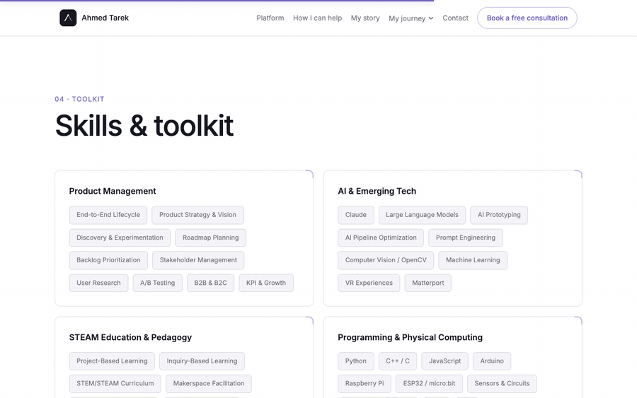</td>
  </tr>
  <tr>
    <td align="center"><sub>🏠 Home: "How can I help" and the Track Method</sub></td>
    <td align="center"><sub>🧭 <code>/product</code>: skills, toolkit and "Let's build something great"</sub></td>
  </tr>
</table>

> [!NOTE]
> These GIFs show **public pages only**. The private tools are never recorded.

<p align="center"></p>

## 🗂 Contents

- [📖 1. The story](#-1-the-story)
- [🧭 2. Product tour](#-2-product-tour)
   - [🌐 2.1 Public site](#-21-public-site)
   - [💼 2.2 /admin: owner hub and client hours](#-22-admin-owner-hub-and-client-hours)
   - [🔗 2.3 /c/:token and /cal/:token: what clients see](#-23-ctoken-and-caltoken-what-clients-see)
   - [⏰ 2.4 /time: days, quarters, focus and prayer times](#-24-time-days-quarters-focus-and-prayer-times)
   - [📅 2.5 /plan: the long-range plan](#-25-plan-the-long-range-plan)
   - [🐞 2.6 /desk: the product desk](#-26-desk-the-product-desk)
   - [🦈 2.7 /finance: Floosy, with the Shark agent](#-27-finance-floosy-with-the-shark-agent)
   - [📝 2.8 /dashboard: content, media and newsletter](#-28-dashboard-content-media-and-newsletter)
   - [🚨 2.9 /security: the intruder log](#-29-security-the-intruder-log)
   - [🎮 2.10 /games/: camera games](#-210-games-camera-games)
   - [🧰 2.11 Shared tool kit](#-211-shared-tool-kit)
- [🧠 3. How it works](#-3-how-it-works)
   - [🌐 3.1 System context](#-31-system-context)
   - [🔀 3.2 Request and data flow](#-32-request-and-data-flow)
   - [🔑 3.3 Auth flow](#-33-auth-flow)
   - [🦈 3.4 Key journey: asking the Shark agent about a purchase](#-34-key-journey-asking-the-shark-agent-about-a-purchase)
   - [📆 3.5 Key journey: a meeting becomes a task, a feed event and a reminder](#-35-key-journey-a-meeting-becomes-a-task-a-feed-event-and-a-reminder)
- [💾 4. Data model](#-4-data-model)
- [📡 5. API reference](#-5-api-reference)
- [🧱 6. Tech stack and third-party services](#-6-tech-stack-and-third-party-services)
- [🔒 7. Security and privacy design](#-7-security-and-privacy-design)
- [📂 8. Project structure](#-8-project-structure)
- [🚀 9. Running, configuring, deploying and testing](#-9-running-configuring-deploying-and-testing)
- [📏 10. Conventions](#-10-conventions)
- [🎨 11. Brand identity](#-11-brand-identity)
- [🚧 12. Known limits and roadmap](#-12-known-limits-and-roadmap)

<p align="center"></p>

## 📖 1. The story

### 😅 The problem

Picture this: a product manager who is also an educator and a freelance consultant. 🎩🎩🎩 Three hats, one head.

Let's be honest about what that head is juggling:

- ⏳ Clients buy blocks of hours, the hours **expire**, and every client wants to see their balance.
- 🌍 Sessions happen across time zones, so someone's "6 PM" is always someone else's "wait, what?".
- 🐞 Several products need someone to triage their bugs.
- 🕌 There are quarterly goals and a daily routine built around five prayer times.
- 💸 There is personal money, in more than one currency (plus some gold, because why not).
- 🎬 And the public portfolio, video hub and newsletter would like to stay current, thank you very much.

Off-the-shelf tools each cover one slice. None of them talk to each other, and most of them want a monthly subscription *and* the owner's data on somebody else's servers. That is eleven tabs, five logins and zero joy. 🫠

So he built his own.

### 👥 Who it is for

| 👤 Who | 🎁 What they get |
|---|---|
| 🌐 **Visitors and prospective clients** | The public site: who the owner is, what he offers, his videos, his résumé in three versions, and a booking link |
| 🤝 **Clients** | A private link with **no login**. It shows their remaining hours, their upcoming sessions in their own time zone, and their session files |
| 🔑 **The owner** | The only person who can sign in. There is exactly **one passkey**, on his phone, and everything private exists for him |

### 💡 Why it exists

> [!TIP]
> **One codebase, one database, everything connected.** A meeting booked in `/admin` shows up as a task on today's list in `/time`, on the client's share page, and in a subscribed calendar. The finance AI reads the same transactions the owner records by hand. A product's live user numbers flow into the desk every week without anyone typing them.

### ☀️ A day with it

1. 📱 **Morning.** He opens `/time` on his phone and taps once for Face ID. The day is already laid out: prayers sit in the half-hour slots their iqama falls in, worked out from where he is right now. Morning and evening azkar, breakfast, a nap, the gym and sleep are placed around them. A client meeting booked last week in `/admin` is in the list with its link, fifteen minutes of preparation ahead of it, in his local time.
2. 🍅 **Focus.** He presses ▶ on the first focus block. This one is a sitting block; the next is standing, and the one after that is walking. (Yes, the app tells him when to stand up. Somebody has to.) A clay sun moves across a 3D sky toward the next prayer. ☀️
3. 🐞 **Mid-morning.** A customer reports a bug. He logs it in `/desk` by answering one question at a time. The desk grades it ("blocks payment, fix today") and puts it straight at the top.
4. 🦈 **Lunch.** He spends some money and tells Floosy by voice. Shark, the agent, checks the request, shows a confirm button, and records the spend **only after he taps it**. No surprise entries.
5. 🎓 **Afternoon.** He runs the client session and records it in `/admin`. The client's hours chart drops, and their share page updates on its own.
6. 🌙 **Evening.** "End of day" lists what slipped and moves it to tomorrow. The Quarter tab shows the goals moving. 📈 Done. Go to sleep. (The app has already scheduled that too.) 😴

<p align="center"></p>

## 🧭 2. Product tour

| 🎯 Area | URL | What you get |
|---|---|---|
| 🌐 Public site | `/`, `/product`, `/educator`, `/full` | Landing page, video hub, a three-view résumé, newsletter, FAQ, booking |
| 💼 Owner hub and client hours | `/admin` | Clients, hour packages, sessions, meetings, a balance chart, calendar feed |
| 🔗 Client view | `/c/:token`, `/cal/:token` | Read-only hours and meetings, no login; a private iCalendar feed |
| ⏰ Time | `/time` | Today, Quarter, Focus, Days, Ideas, Analytics, Plan; prayer times, 3D sky, planner |
| 📅 Plan | `/plan` | The long-range four-phase plan with charts and milestones |
| 🐞 Product desk | `/desk` | Bug and request inbox with automatic grading and a fix-day queue |
| 🦈 Floosy | `/finance` | Personal finance app with the Shark AI agent, voice and 3D |
| 📝 Dashboard | `/dashboard` | Edit the public pages, media library, write and send the newsletter |
| 🚨 Security | `/security` | Intruder log with camera snapshots and IP blocking |
| 🎮 Games | `/games/` | Webcam-controlled 3D volleyball and boxing |


### 🌐 2.1 Public site

| URL | File | What it is |
|---|---|---|
| `/` | [`index.html`](index.html) | The landing page |
| `/product`, `/educator`, `/full` | [`journey.html`](journey.html) + [`js/site/journey.js`](js/site/journey.js) | One résumé, three views |
| `/unsubscribe` | → [`api/cms.js`](api/cms.js) | Newsletter opt-out |

**Landing page (`index.html`).** Sections:

- Hero
- Video hub (`#content`)
- About
- How I can help (`#help`)
- Platform track rail
- Testimonials
- Free resources
- FAQ (written for three kinds of visitor)
- Newsletter sign-up
- Contact, with a "book a free consultation" call to action

Phones get a bottom tab bar ([`js/site/tabbar.js`](js/site/tabbar.js)). The page is exported from a design tool and painted in the browser by [`js/runtime/support.js`](js/runtime/support.js); see [Things that have bitten us](#-things-that-have-bitten-us).

**Video hub ([`js/site/videos.js`](js/site/videos.js)).**

- Three videos. Clicking one plays it in the main frame using `youtube-nocookie.com`.
- The owner only enters a YouTube link. Thumbnails, titles and channel names are fetched from YouTube: thumbnails from the image CDN, titles and channels through oEmbed, with no API key.
- `maxresdefault.jpg` is measured before use, because a missing one comes back as a 120 px placeholder rather than an error. If it is too small, the hub falls back to `hqdefault.jpg`.
- "Subscribe" opens YouTube's own subscribe dialog in a popup.

**Journey pages.**

- `journey.js` reads the path (or `?view=`) and renders a different selection and order of chapters from the résumé data at the top of the file:
  - `/full` shows everything.
  - `/educator` shows the teaching story.
  - `/product` (the default) shows the builder story.
- `applyViewMeta()` rewrites the title, description, canonical URL, link preview and JSON-LD for each view.
- Each view offers its own CV PDF from `assets/` and a "book a call" button.
- Visual details:
  - scroll reveals using IntersectionObserver
  - stat count-ups
  - a lightbox with keyboard controls
  - card tilt
  - a custom cursor
  - an animated "aurora" background
- A cookie banner is shown. The contact form posts to a form service and falls back to `mailto:`.
- Analytics events are sent for leads, product clicks and video plays.

**Content overlay ([`js/site/cms.js`](js/site/cms.js)).** Words, pictures and links on the public pages are edited in `/dashboard` and applied at load:

- `cms.js` walks the rendered DOM and gives every text run, image and outbound link a stable key. The key is the design runtime's template id, or else a hash of the *original* content, or an explicit `data-cms-key`.
- One public `GET /api/cms` returns every override.
- Links are checked against a scheme allowlist both when saved and when applied.
- When it finishes, `cms.js` fires `cms:applied`, and other scripts rebuild on that event.
- The HTML holds the default text. That default is shown when there is no override and when the database cannot be reached.
- One sitewide setting controls the booking URL behind every `[data-cta="book"], [data-book]` button.

**Newsletter sign-up ([`js/site/newsletter.js`](js/site/newsletter.js)).** Posts to `POST /api/cms?resource=newsletter`. The form has a honeypot field and a per-IP rate limit. Every subscriber gets a personal unsubscribe token.

**Findability.**

- [`robots.txt`](robots.txt) allows all crawlers, AI crawlers included, and names each one explicitly. Every private path is repeated in every crawler's group, because a crawler that finds a group with its own name ignores `User-agent: *`.
- [`sitemap.xml`](sitemap.xml) lists the four public URLs.
- `index.html` carries a JSON-LD `@graph` with `Person`, `ProfessionalService`, `WebSite` and `FAQPage`. The `FAQPage` data mirrors the visible FAQ.
- `logo/link-preview.jpg` is the social preview card.
- The `*.txt` file at the root is the IndexNow key file. Deleting it makes URL submissions fail silently.

### 💼 2.2 /admin: owner hub and client hours

Files: [`admin.html`](admin.html), [`js/tools/admin.js`](js/tools/admin.js), [`js/tools/chart.js`](js/tools/chart.js), [`js/tools/meetings.js`](js/tools/meetings.js), [`js/tools/files.js`](js/tools/files.js), [`js/tools/country.js`](js/tools/country.js). Server: [`api/clients.js`](api/clients.js), [`api/packages.js`](api/packages.js), [`api/sessions.js`](api/sessions.js), [`api/pdf.js`](api/pdf.js), [`api/_lib/hours.js`](api/_lib/hours.js), [`api/_lib/meetings.js`](api/_lib/meetings.js), [`api/_lib/files.js`](api/_lib/files.js).

**Sign-in and the hub.**

- On first visit the page offers "Register your device", which creates the only passkey. After that it offers "Sign in".
- The home screen greets the owner and shows tiles for Product desk, Clients (with quick facts), Time and Finance, plus links to the Security log and Site content.

**Clients list.**

- An upcoming-meetings agenda with filters: Today, Tomorrow, This week, Next week, This month and All, each with a count.
- An "Add to Google Calendar" dialog.
- An add-client wizard and the full client list.
- **Meeting settings:**
  - the owner's own time zone, either automatic from the device or pinned to one zone
  - the usual meeting link
  - the address that receives the owner's copy of reminders

**Client page.**

- Profile fields: name, contact, nationality, transaction type, notes and gender.
- The country is inferred from the phone dialling code.
- An optional photo, cropped in the browser to a small square before it is uploaded.
- A **share link** that can be created or revoked: `/c/<token>`.
- Totals paid, broken down by currency. These are admin-only and never sent to the share page.
- Deleting a client cascades to their purchases, sessions and meetings, after a confirmation.

**Hours packages.**

- Records a purchase of N hours with a purchase date and an expiry date. The expiry defaults to one month later and can be set from 1 to 24 months.
- An optional payment-proof image or PDF can be attached, up to 3 MB.

**Sessions.**

- Each session has a date, hours, a topic and an optional file: minutes or slides in PDF, PowerPoint, Keynote, OpenDocument or Word format.
- Files up to 20 MB are uploaded in 2.5 MB chunks, with progress and a drop box, and joined on save.

> [!TIP]
> **Hours engine (`api/_lib/hours.js`)** is the single source of truth for hours. Nothing else recomputes balances.

**How the engine counts.**

- It replays purchases, sessions and expiries in date order.
- Each session uses hours from the package that **expires soonest**.
- On the day after a package's expiry date, whatever is left in it becomes *expired hours*.
- Time that no active package covers is shown as *unpaid hours*.

**Balance chart (`js/tools/chart.js`).**

- An SVG step chart that rises on a purchase, falls with each session and drops on an expiry.
- The line is solid up to today and dashed after, so future expiries are projected.
- It has a crosshair tooltip, a draw-in animation, range chips (All, 30 days, 90 days, 1 year) and custom dates.
- The same file also draws the pace, step and donut charts used by `/time`.

**Meetings.**

- A meeting is stored as a moment in time plus the zone it was arranged in. Each viewer sees it in their own zone:
  - the owner, in his zone, with the client's time shown underneath
  - the client's share page, in the browser's zone
  - reminder emails, in the zone the meeting was arranged in
- **Repeat** every week or every two weeks on chosen weekdays. A series can end:
  - when the client's credit runs out (the default, worked out with the hours engine)
  - after a number of sessions
  - on a date

  A live preview lists every date before anything is saved. Series are capped at 60 meetings. Each meeting in a series can be moved or deleted on its own, or with "the ones after it".
- **Change link for all upcoming** puts one new link on every future meeting of a client, with an option to make it the default.
- A meeting that has happened can be turned into a session record with **Record as session**.
- Link previews detect the platform (Zoom, Google Meet, and so on).

**Calendar feed.**

- "Make my calendar link" creates a private `/cal/<token>.ics` feed that Google or Apple Calendar can subscribe to (the Apple link uses `webcal:`).
- **Rotate** kills the old link.
- A cancelled meeting is kept as a *tombstone* (`cancelled_meetings`) and published as `STATUS:CANCELLED`. Without that, subscribed calendars would keep showing the event.

**Reminder emails (built, switched off).**

- Reminders go out one day before and two hours before, to the client and to the owner.
- See [Known limits](#-12-known-limits-and-roadmap) for how to switch them on.

### 🔗 2.3 /c/:token and /cal/:token: what clients see

[`share.html`](share.html) + [`js/tools/share.js`](js/tools/share.js), served data by [`api/share.js`](api/share.js).

- There is no login. The page opens only with the long random token in the URL. A bad token shows "Link not valid".
- It shows:
  - the client's name
  - a hero card for the next meeting and a list of upcoming ones, in the visitor's own time zone and refreshed every minute
  - the hours-balance chart with range chips
  - hours purchased and sessions held
  - downloadable session files
- It deliberately leaves out money amounts, admin notes and contact details.
- `/cal/<token>` is the owner's private iCalendar feed of all meetings (see above).

### ⏰ 2.4 /time: days, quarters, focus and prayer times

Files: [`time.html`](time.html), [`js/tools/time.js`](js/tools/time.js) plus `time-cal.js`, `time-clock.js`, `time-fx.js`, `time-sky.js`, `week.js` and `prayer.js` in [`js/tools/`](js/tools/), and [`css/tools/time.css`](css/tools/time.css) and [`css/tools/time-3d.css`](css/tools/time-3d.css). Server: [`api/tasks.js`](api/tasks.js), [`api/quarters.js`](api/quarters.js), [`api/goals.js`](api/goals.js), [`api/ideas.js`](api/ideas.js), [`api/day-photos.js`](api/day-photos.js), [`api/_lib/routines.js`](api/_lib/routines.js), [`api/_lib/quarter.js`](api/_lib/quarter.js), [`api/_lib/goal-backfill.js`](api/_lib/goal-backfill.js).

The tabs are **Today · Quarter · Focus · Days · Ideas · Analytics · Plan**. The last tab used is remembered, and each tab has its own colour scheme.

**Above the tabs.**

- Live counters that tick every second:
  - age
  - time left to an income goal by a target age
  - a countdown to the next income milestone
  - the selected quarter's countdown, with "Day X of Y" and a progress bar
- A collapsible **milestone ladder** of ten amounts. Each is half the next, and they are spaced evenly in time. Each can be ticked off with the amount actually earned.
- A **weekly routine card** ([`week.js`](js/tools/week.js)):
  - a Saturday-to-Friday strip with a purpose for each day
  - "ticket" rows that can be reordered and can repeat every N weeks
  - a job-applications quota counter
  - downloadable whole-week images
  - It is stored in the desk's JSON document under the `week` key.

**Today.**

- Day navigation and a mascot whose mood follows the day's percentage, with confetti at 100%.
- **Gamification:**
  - a five-month commitment-cycle level bar
  - 17 badges, each computed from real data (tasks done, streaks, goals reached, focus blocks, milestones)
  - Each badge's goal can be tuned or reset.
- **Tasks.** Each task has:
  - an icon, title and quarter category
  - planned and actual hours
  - a time range and a note
  - a meeting link
  - done or **half done** (counts as 0.5)
  - a "done at" time set on a 24-hour dial
  - drag-to-reorder using Pointer Events, so it works on touch
- Bulk select and delete, clear the day, or copy the day to another date.
- **Quick Pomodoro:**
  - a full-screen "work alone" timer with focus, short-break and long-break phases (a long break every fourth round)
  - editable durations
  - client-only: nothing is sent to the server
- **Day completion chart** of the day's completion over time, and a **last 14 days** strip.
- **Prayer times and an auto-filled day ([`prayer.js`](js/tools/prayer.js)):**
  - Location comes from the browser's geolocation, named through reverse geocoding, or from a typed place.
  - Times come from a prayer-times API using each country's official method. Offline, the same times are calculated on the device from the sun's position.
  - Iqama waits have per-country defaults and are editable.
  - Each prayer becomes a task in the half-hour slot its iqama falls in. Friday Dhuhr becomes Jumu'ah. Azkar, breakfast, a nap, the gym on chosen days, and sleep until the next Fajr are placed around the prayers.
  - Tasks the owner has finished, deleted or retimed by hand are never moved again (`auto_key`, `:hand`, `task_skips`).
  - If location fails, a per-browser help guide appears.
- **Repeating events (🔁).** Google-Calendar-style rules: title, icon, category, time, weekdays, and start and end dates. When a day from today onwards is opened, `GET /api/tasks?date=&sync=1&tz=`:
  - creates each rule's task once
  - places client meetings in the viewer's zone with 15 minutes of preparation
  - removes tasks whose meeting moved or was cancelled
- **Calendar views ([`time-cal.js`](js/tools/time-cal.js)):**
  - List, Day, Week and Month, with an "Anytime" row
  - On future days, repeats, meetings and prayers appear as dashed previews.
  - In the Day and Week grids, blocks can be dragged to move them and their edges dragged to resize them.
- **Plan my day (🧠).** A local planner. It uses no AI and sends nothing anywhere.
  - Input: rows with a duration, ⭐ important and ⚡ urgent flags, and an optional fixed time.
  - **Eisenhower squares** with drag between them, a Top 3, and estimates padded by 30%.
  - Tasks under two minutes are marked "do now". Calls, errands and messages are batched.
  - Hard work goes into focus hours. Other work fills the free gaps around prayers and meetings, with buffers. Anything over 50 minutes is split into 🍅 rounds.
  - The owner reviews and edits the plan before saving.
- **End of day (🌙).** Lists what was not finished, asks "why did it slip", and moves ticked items to tomorrow.
- **Add to Google Calendar.**
  - Today it downloads an `.ics` file and opens Google's import page.
  - A Google Identity and Calendar API path is written, but it is inactive until an OAuth client ID is configured.
- **Playful layer:**
  - a 3D clay clock time picker ([`time-clock.js`](js/tools/time-clock.js))
  - tilt and ripple effects, phone vibration, and emoji bursts with short jokes ([`time-fx.js`](js/tools/time-fx.js))
  - a Three.js **3D sky** ([`time-sky.js`](js/tools/time-sky.js)): a clay sun or moon crosses from sunrise to sunset, with a lantern at each prayer. It falls back to a gradient without WebGL.
  - Reduced motion is respected throughout.

**Quarter.**

- A gallery of quarter cards, each marked upcoming, current or past, with:
  - execution % (average daily completion)
  - goals % (weighted by target)
  - a trend chart
- **Quarter form:**
  - name and dates, with 21-, 30- and 90-day shortcuts
  - days off per quarter
  - which plan phase the quarter runs on
  - an **anti-perfectionist mode**, where 75% of a target counts as done
  - copying categories and goals from an earlier quarter
- **Category rows:** weekly hours (optional; a category can be goals-only) and a plan track (business, brand, job or learning).
- **Detail view:**
  - category cards with weekly and quarter targets, hours logged, hours remaining and pace
  - goal rows with ± current and target values, due-date chips, and a button to add the goal to today
  - **By category** and **All goals** views (in All goals, goals can be reordered and hidden)
  - drag-to-reorder for categories and goals
- **Goal due dates:**
  - Each track gets a stretch of the quarter's working days, sized by the plan phase's hours for that track ("in series").
  - The goals in a track's stretch split its days equally.
  - Due dates are derived on the client and never stored.

**Focus.**

- A daily checklist of focus blocks. There are 10 by default, or the number is derived from "hours today" using a 25 on / 5 off / 15 after every fourth rhythm.
- Postures rotate between sitting, standing and walking.
- ▶ runs a 25-minute block with pause, "done now" and stop. The tab title shows the countdown, and a running block survives a page reload.
- The list resets at a fixed-zone midnight. A 14-day history is shown.

**Days.**

- Pick a quarter, or all quarters.
- A daily completion chart with the goals line overlaid. Estimated history is drawn dashed.
- Range focus: this week, last week, last 4 weeks, the whole quarter, or custom.
- A **photo gallery** with one tile per day. Images are resized in the browser to a thumbnail and a full-size copy.
- **Fill empty days** from a one-task-per-line template, and mark days as estimated.

**Ideas.** A free-form list with inline editing and drag-to-reorder.

**Analytics.** For the selected quarter:

- donuts for hours by category, pace status, goals by category and goal status
- bars for hours pace and goal completion

### 📅 2.5 /plan: the long-range plan

- `/plan` is a rewrite to `GET /api/tasks?plan=page`. It is an HTML page held inside [`api/_lib/plan.js`](api/_lib/plan.js) so it stays behind the passkey.
- The Plan tab in `/time` shows it in an iframe sized to its content. "Open on its own ↗" opens it full-screen.
- What the page holds:
  - a four-phase plan with hours per day across four tracks (business, brand, job, learning)
  - milestone ticks; ticking one early or late shifts the milestones after it
  - "in series" date stretches with weekends
  - pomodoro counts
  - Chart.js charts with All, Around now and This phase zoom
  - its own English/Arabic switch
- State is saved with `GET`/`PUT /api/tasks?plan=state` in `app_settings`, so every device sees the same plan.

### 🐞 2.6 /desk: the product desk

[`desk.html`](desk.html), [`js/tools/desk.js`](js/tools/desk.js), [`css/tools/desk.css`](css/tools/desk.css); server [`api/_lib/desk.js`](api/_lib/desk.js) via `api/ideas.js?desk=`.

One inbox for bugs, feature requests and ideas across several products. It grades each item with fixed rules:

| Grade | Rule |
|---|---|
| 1, fix today | It stops payment or sign-in, or loses data |
| 2, fix day | Any other bug, or a feature once enough paying customers have asked (configurable) |
| 3, later | Everything else. It is dropped after a configurable number of days, and a new customer request restarts the countdown |

**Fix-day queue.**

- Items are ordered by weighted shortest job first, that is, value per hour.
- Value comes from reach, source, workaround, frequency, outcome, churn risk, evidence, requests, due date and age.
- Each fix day has an hour budget. Work that does not fit rolls over, planned up to 12 fix days ahead.
- Products in maintenance mode get one hour, on the first fix day of the month.

**Tabs.**

| Tab | What it shows |
|---|---|
| Today | In progress, Fix now, the next fix day, and banners |
| Fix day | The queue, grouped by date with budget used |
| Later | Parked items, with a countdown to the next drop |
| Numbers | Weekly product numbers (below) |
| Closed | Done, dropped and expired items, with Bring back |
| Products | The product cards |
| Rules | The rules in plain words, the fix-day weekday, the dials, and JSON backup or restore |

**Logging wizard.**

- Asks one question at a time, shaped as a user story: As a… / I want… / So that…, then blocks, workaround, frequency, reach, due date, evidence, before and after screenshots (pasted or picked), an effort dial and acceptance criteria.
- Each answer explains the rule it triggers.
- A live ticket preview types itself out beside the questions.

**Ticket view.**

- A 3D tilting card with a typewriter reveal.
- "Copy ticket" copies plain text, ready for an issue tracker.
- Linked clients.
- Screenshot viewer with a before/after compare slider.
- "Why this score" shows how the score was worked out.
- A split-flap countdown.

**Numbers.**

- One figure per product per week.
- **Right now:** a live panel refreshed every minute with users, paying users and conversion. Products are grouped by market, and each product has a three-note audio "voice".
- A canvas "crowd" with one figure per user.
- A searchable live users list, proxied and never stored.
- An SVG chart in two modes, Growth (indexed to 100) and Conversion %, with a legend, solo buttons and an average line.
- A "flat for two weeks" warning and a system notification when the weekly capture lands.

**Weekly capture.** A Vercel Cron job (see [`vercel.json`](vercel.json)) calls `GET /api/ideas?desk=cron` once a week. The server reads every connected product's stats endpoint and writes that week's numbers into the desk document.

**Products tab.**

- Each product card holds a logo, category, country, B2B or B2C, the customer, what they care about, channels, the weekly metric, and a stats URL (which must be https).
- Each product is marked active or in maintenance.

**Offline.** On `localhost` the whole desk runs from `localStorage` with no server.

### 🦈 2.7 /finance: Floosy, with the Shark agent

[`finance/`](finance/) (static ES modules) plus server [`api/_lib/finance.js`](api/_lib/finance.js), [`api/_lib/advisor.js`](api/_lib/advisor.js) and [`api/_lib/claude.js`](api/_lib/claude.js), reached through `api/ideas.js?finance=`.

A personal money planner. It is Arabic-first (right to left), with English, and installable as a home-screen web app ([`manifest.webmanifest`](finance/manifest.webmanifest)).

**Pages.** Home, Analytics and Log, with a chat side panel for the **Shark** 🦈 agent.

**Home: "rooms" of cards.** The rooms are Today, Essentials, Wallets, Goals, Fun and Rules.

- **Today:**
  - how much can be spent today
  - days until payday
  - what is left for essentials
  - a quick "＋ Spent" button
- **Cards:**
  - "what to do now"
  - a month view with day, month and year navigation
  - a country view switch, where each country shows in its own currency
  - essentials budget items
  - wallets per currency, and a debt list ordered by drag
  - living levels
  - safety-fund milestones with projected dates
  - a "fun money" jar with outing goals
  - big goals
  - charity
  - an investing plan and holdings
  - the risk ladder
  - transactions
  - payday and a pro-rated first salary
  - currency transfers
- "Why" pop-overs explain each number. Undo toasts, count-ups and confetti give feedback.
- A masonry layout with FLIP reflow, and a light that follows the cursor or finger.

**The money engine ([`finance/rules.js`](finance/rules.js)).**

- Every income is split by fixed percentages into growth, safety, essentials and reward. Debt is paid first out of the growth share.
- Three modes, chosen by income against essentials.
- Charity comes off the top.
- Essentials can depend on where the household lives.
- Supported currencies include several fiat currencies and gold by weight. Conversions use the rate on the transaction's date.
- Salary can be recorded automatically on payday.
- [`finance/goals.js`](finance/goals.js) simulates future months for big goals (cash, instalments or monthly cost).
- [`finance/invest.js`](finance/invest.js) projects a risk-ladder mix with low, mid and high scenarios.

**Guided flows.** Step-by-step wizards with a final confirmation:

- [`split-wizard.js`](finance/split-wizard.js): where an income goes
- [`ess-wizard.js`](finance/ess-wizard.js): essentials
- [`xfer-wizard.js`](finance/xfer-wizard.js): transfers, gold, paying debt
- [`tx-edit.js`](finance/tx-edit.js): edit or delete a transaction

Typed text is routed in one of three ways:

- A bare amount asks "what was this?".
- A pasted "name: amount" list becomes essentials items.
- Anything else goes to an AI intent classifier.

**Analytics ([`finance/analytics.js`](finance/analytics.js)):**

- key numbers for the cycle
- an expected timeline
- net worth over time
- income against spending per cycle
- where the income went
- breakdowns by category

**Log ([`finance/logpage.js`](finance/logpage.js)):**

- every transaction, with its historical rate and fees
- filters by period, type and currency, plus text search
- CSV export of the filtered period

**The Shark agent.**

- `?finance=agent` is a Claude tool-use loop.
  - The server runs one model step per request.
  - The tools run in the browser, because the money engine lives there. The page sends tool results back, up to 24 steps, until the turn ends.
- **Tools.** The full set is in `api/_lib/advisor.js`.
  - Numbers: `simulate_goal`, `compare_goals`, `simulate_situation`, `spending_summary`, `invest_projection`, `list_transactions`.
  - What the owner sees: `show_chart` (animated charts in the reply) and `point_to` (the Shark cursor glides to a card).
  - Asking the owner: `ask_user` (a question with option buttons).
  - Changing data: `record_expense` and `add_goal`.
  - Other: `ask_council`, `request_feature`, `propose_action`, and a server-side `web_search` limited in uses.
- **Guardrails** 🛡:
  - Writes (`record_expense`, `add_goal`) show a confirm button, and nothing is saved without a tap.
  - The agent never auto-presses an option that looks like save, confirm or delete.
  - The system prompt forbids inventing numbers or religious references. Numbers must come from tools.
- **Context caching.** The first step builds a cached snapshot of the data plus chat memory (`finance_agent_ctx`). Later steps send only the diff since the snapshot.
- **Council (`?finance=advise`).** Five advisor personas answer in parallel, and a chair gives the verdict. The result is shown as a 3D round table. The page sends only computed facts.
- **Chat and intent (`?finance=chat`, `?finance=intent`).** Free questions answered from a summary of the data, and classification of what was typed.
- **Memory.** Chat lines are kept in `finance_chat` and fed back as context.
- **Models.** Claude through the Anthropic SDK, with server-side fallback and prompt caching. When no Anthropic key is set, the council, chat and intent fall back to Google Gemini (an ordered model list that fails over). The agent itself needs Claude.
- **Kill switches.** Sound, Voice and AI can each be switched off from 🎛 controls. The AI switch is enforced both in the browser and on the server, which returns 403 before any paid call.

**Shark mode, 3D and sound.**

- A full-screen mode ([`shark-mode.js`](finance/shark-mode.js)) with:
  - big paged messages read aloud
  - comic speech bubbles
  - a cursor that tours the cards while the agent works
  - a speech-speed control
- A Three.js swimming shark ([`shark3d.js`](finance/shark3d.js)) with idle, talk, listen and think states, and a 2D fallback.
- A 3D hero scene of a coin and four bucket wallets ([`scene.js`](finance/scene.js)).
- All sound effects are generated in code with Web Audio, with no audio files ([`sfx.js`](finance/sfx.js)). Haptics are included.

**Voice ([`finance/voice.js`](finance/voice.js)).**

- **Speaking.** Text-to-speech runs on the server through a voice API (`?finance=tts`). It falls back to Piper TTS running in the browser (WASM, model cached in OPFS) and to the browser's `speechSynthesis`. Captions follow along.
- **Listening.** The microphone is recorded with `MediaRecorder`. A Web Audio analyser detects silence and stops the recording, which is then transcribed on the server (`?finance=stt`).

> [!NOTE]
> The PIN is a privacy and confirmation layer. Real access control is always the passkey session on the server.

**PIN gate.** Numbers are hidden (•••) until a numeric PIN is entered. The PIN is also asked for before:

- editing essentials
- editing or deleting a transaction
- wiping data
- changing the controls
- importing over existing data

The unlock lasts until the tab closes (`sessionStorage`). Two wrong PINs are logged to `/security`. The PIN is a privacy and confirmation layer; real access control is the passkey session on the server.

**Storage and sync.**

- The whole state is **one JSON document** (`finance_state`, a single row with a `rev` counter).
- Saves are debounced and sent with `If-Match: <rev>`. A conflict returns 409 with the newer document, and the tab adopts it.
- Tabs re-sync on focus and every 20 seconds.
- Rolling backups are kept in `finance_backups`.
- One-time server-side data migrations are recorded in the document as applied.
- The full JSON can be exported and imported.
- On a 401, unsaved edits are parked in `sessionStorage`. The page sends the owner to sign in and restores the edits afterwards.
- There is no service worker; the app needs the network.

### 📝 2.8 /dashboard: content, media and newsletter

[`dashboard.html`](dashboard.html), [`js/tools/dashboard.js`](js/tools/dashboard.js), server [`api/cms.js`](api/cms.js) + [`api/_lib/mail.js`](api/_lib/mail.js).

**Content.**

- Pick a page: Home, Full story, Educator or Product.
- The page loads in a hidden iframe with `#cms-index`. `cms.js` there sends back over `postMessage` every editable item, exactly as rendered.
- Fields are grouped by section, with pictures first. Styled runs show as `**asterisks**`.
- "Show everything" reveals the short labels and links that are folded away by default.
- Save sends only the fields that changed. Clearing a field reverts it to the page's own text.

**Media library.**

- Images are re-encoded in the browser (WebP or JPEG) and capped at about 3 MB.
- They are served from `/api/cms?resource=media&id=N` with immutable caching.
- A picker lets a field use a library image or a URL.

**Newsletter.**

- The subscriber list, with CSV export and removal.
- **Composing** is plain text:
  - a blank line starts a paragraph
  - `**bold**`
  - `- bullet`
  - `[text](url)`
- "See how it looks" renders the real email with the same code that sends it. There is also "Send a test to me".
- "Send to everyone" sends in chunks of 60, driven by the browser loop with progress, so no single request can time out.
- Past campaigns are listed.
- Each email carries a personal unsubscribe link and a `List-Unsubscribe` header.

**Unsubscribing.** The GET request only asks; a POST does the unsubscribe. This way, mail scanners that open every link cannot unsubscribe people. The subscriber row is kept with its status flipped, not deleted.

### 🚨 2.9 /security: the intruder log

[`security.html`](security.html), [`js/tools/snap.js`](js/tools/snap.js), [`api/_lib/intruder.js`](api/_lib/intruder.js).

**Recording failed attempts.**

- From the second failed passkey sign-in, or the second wrong finance PIN, the page may take **one** front-camera frame if the browser allows it.
- That frame is posted with the page, a note, the IP address and the user agent.
- If the camera is refused, the attempt is still logged.

**Opening the log.** It needs two things:

- a signed-in passkey session
- a separate passcode, asked for every time the page opens

A correct passcode returns a short-lived unlock token. The page keeps it in memory only and sends it as a header, so a refresh asks again.

**Actions.**

- Clear the log.
- Block or unblock an IP address. A blocked address is refused at every sign-in step. The owner cannot block the address he is currently using.

### 🎮 2.10 /games/: camera games

Static, unlisted, and using no server: [`games/index.html`](games/index.html) + [`game.js`](games/game.js), and [`games/boxing.html`](games/boxing.html) + [`boxing.js`](games/boxing.js).

Both games use **Three.js** for 3D and **MediaPipe Pose Landmarker** for body tracking. Both are vendored in `games/vendor/`. Body tracking runs on the GPU, with a CPU fallback.

**Camera Volley 3D.**

- Volleyball with the camera behind the player's side of the court, so the player's own movements map straight onto the screen.
- The game is against the CPU. A second person in the right half of the webcam image can take the far side.
- First to 7 wins, and there is a demo mode.
- Keys: Space serves, R restarts, C changes the camera view.

**Boxing vs CPU.**

- Punch toward the screen. Raise both gloves to block, lean to slip a straight, and duck a hook.
- One 90-second round, or until a knockout.
- It can be played from the keyboard without a camera: J and K punch, A and D lean, S ducks, B blocks.
- `window.boxing` exposes the game state for tests.

`vercel.json` allows the camera only on `/games/` (and on the private pages that take a security snapshot).

### 🧰 2.11 Shared tool kit

Used across the private pages:

- [`js/tools/theme.js`](js/tools/theme.js): light/dark theme, stored in `tools-theme`. It is set before CSS loads, so the page never flashes the wrong theme.
- [`js/tools/i18n.js`](js/tools/i18n.js): English/Arabic with right-to-left layout. Every string carries both languages where it is used: `T("Save","حفظ")` in scripts, `data-ar` in markup.
- [`js/tools/go.js`](js/tools/go.js):
  - synthesized Web Audio sounds
  - large tile pickers in place of `<select>`
  - one-question-at-a-time form wizards (`form[data-wizard]`) with a review step
  - a motion pack with confetti
- [`js/tools/icons.js`](js/tools/icons.js): shared SVG icons.
- [`js/tools/snap.js`](js/tools/snap.js): the failed-attempt camera snapshot.
- Styles:
  - [`css/tools/app.css`](css/tools/app.css): the shared shell
  - [`go.css`](css/tools/go.css): the house style
  - [`tide.css`](css/tools/tide.css): the palette, loaded last, with contrast notes

<p align="center"></p>

## 🧠 3. How it works

### 🌐 3.1 System context

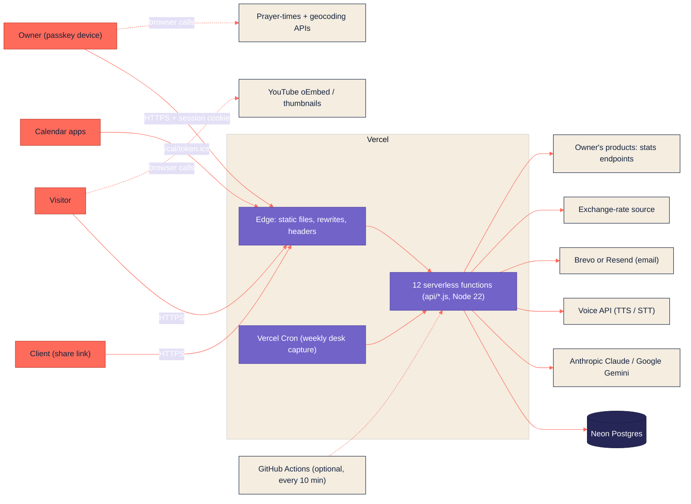

### 🔀 3.2 Request and data flow

Static pages are served directly. Friendly URLs are rewrites in [`vercel.json`](vercel.json). Every data call is a `fetch` to `/api/<name>`.

Vercel's Hobby plan publishes at most twelve functions, so several features share one function and are told apart by a query parameter:

```mermaid
%%{init: {'theme':'base','themeVariables':{'primaryColor':'#7263C9','primaryTextColor':'#ffffff','primaryBorderColor':'#4C3FA0','lineColor':'#FF6B5B','secondaryColor':'#E3E0F6','tertiaryColor':'#F4EDE0','actorBkg':'#7263C9','actorBorder':'#4C3FA0','actorTextColor':'#ffffff','signalColor':'#FF6B5B','noteBkgColor':'#F4EDE0','noteTextColor':'#14213D','fontFamily':'Inter'}}}%%
flowchart TD
  subgraph Browser
    P1["/admin"] & P2["/time"] & P3["/desk"] & P4["/finance"] & P5["/dashboard"] & P6["public pages"]
  end
  P1 --> clients & packages & sessions & pdf
  P2 --> tasks & quarters & goals & ideas & dayphotos["day-photos"]
  P3 -->|"?desk="| ideas
  P4 -->|"?finance="| ideas
  P5 --> cms
  P6 -->|"GET /api/cms (public)"| cms
  share["share (public, token)"]
  auth["auth"]
  P1 & P2 & P3 & P4 & P5 --> auth

  sessions -->|"?resource=meetings / settings / upload"| L1["_lib/meetings.js, files.js"]
  tasks -->|"?routines / ?plan / ?pomodoros / ?sync"| L2["_lib/routines.js, plan.js"]
  ideas -->|"?finance"| L3["_lib/finance.js → advisor.js → claude.js"]
  ideas -->|"?desk"| L4["_lib/desk.js"]
  clients & share --> L5["_lib/hours.js"]
  cms --> L6["_lib/mail.js"]
  auth --> L7["_lib/intruder.js"]

  classDef page fill:#FF6B5B,stroke:#BF3A2A,color:#14213D
  classDef fn fill:#7263C9,stroke:#4C3FA0,color:#ffffff
  classDef lib fill:#262757,stroke:#191A3C,color:#ffffff
  classDef pub fill:#9184D9,stroke:#4C3FA0,color:#17181F
  class P1,P2,P3,P4,P5,P6 page
  class clients,packages,sessions,pdf,tasks,quarters,goals,ideas,dayphotos,cms,auth fn
  class share pub
  class L1,L2,L3,L4,L5,L6,L7 lib
```

**Shared patterns.**

- **Lazy schema.** [`api/_lib/db.js`](api/_lib/db.js) runs `CREATE TABLE IF NOT EXISTS` / `ADD COLUMN IF NOT EXISTS` once per function instance. There are no migration files. Feature modules (`finance.js`, `desk.js`, `intruder.js`, `routines.js`) create their own tables the same way.
- **Single-document state.** Finance and the desk each keep one JSONB row with a `rev` counter, and use optimistic concurrency (`If-Match`, `X-Rev`, 409 plus the current document).
- **Uniform errors.** `withErrors()` logs the real error and returns a generic 500.
- **Tagged-template SQL everywhere.** No SQL is built from strings.

### 🔑 3.3 Auth flow

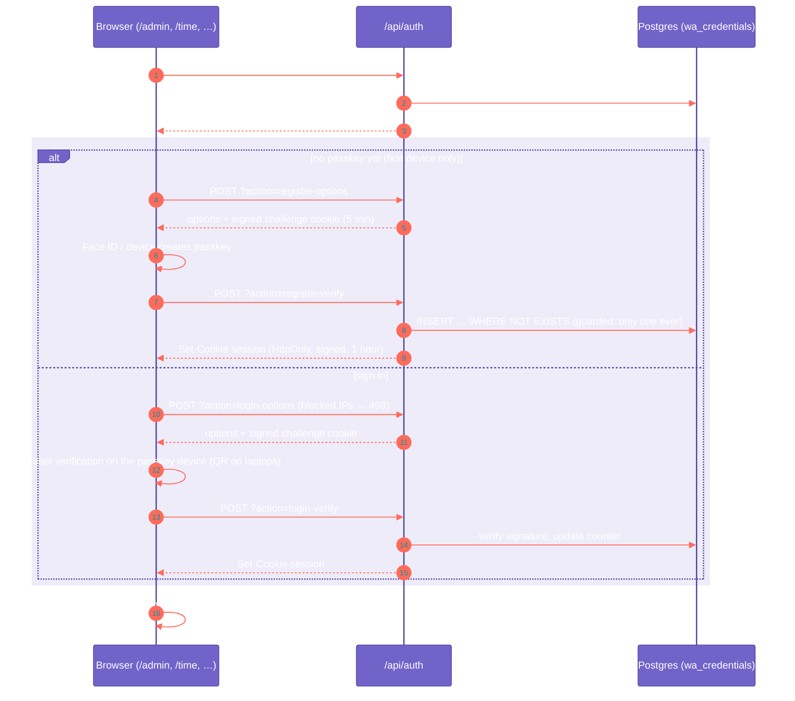

Every private endpoint calls `requireAuth()`. It verifies the HMAC-signed session cookie and its expiry, and returns 401 otherwise. The pages answer a 401 by showing the sign-in view.

### 🦈 3.4 Key journey: asking the Shark agent about a purchase

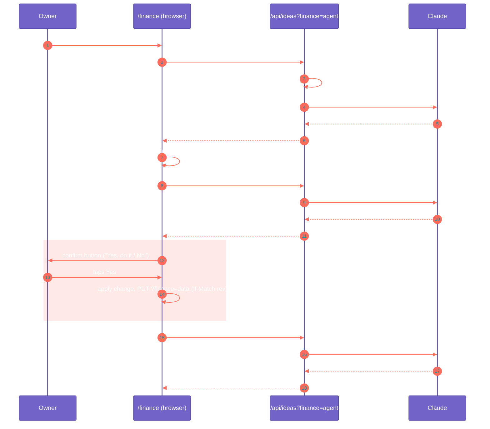

### 📆 3.5 Key journey: a meeting becomes a task, a feed event and a reminder

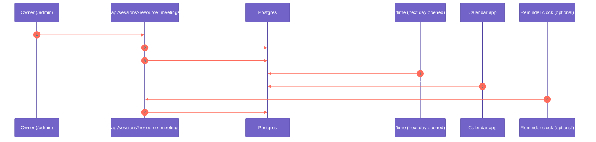

<p align="center"></p>

## 💾 4. Data model

All tables live in Neon Postgres and are created lazily (see [`api/_lib/db.js`](api/_lib/db.js) and the per-feature modules named below).

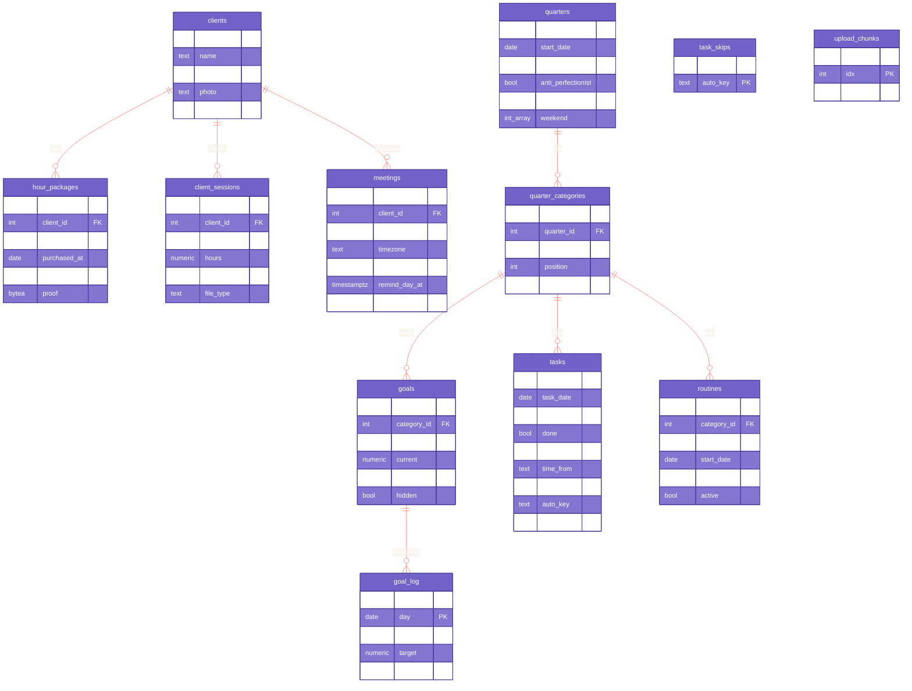

<details>
<summary>🔧 <b>Full data dictionary</b>: all 31 tables, where each is created, and what it holds</summary>

Every table, including the ones in the diagram (only the foreign-key relationships are drawn):

| Table | Created in | Purpose |
|---|---|---|
| `wa_credentials` | `db.js` | The single WebAuthn passkey: id, public key, signature counter, transports, label |
| `clients` | `db.js` | Client profile: name, contact fields, nationality, transaction type, gender, notes, photo (data URL), share token, last-used time zone |
| `hour_packages` | `db.js` | Hour purchases: hours, optional amount and currency, purchase and expiry dates, note, optional payment proof (bytes, name, type) |
| `client_sessions` | `db.js` | Sessions held: date, hours, topic, optional file (bytes, name, type, size) |
| `upload_chunks` | `db.js` | Temporary pieces of large session files, joined on save |
| `meetings` | `db.js` | Scheduled meetings: instant, duration, arranged-in zone, link, topic, series id, reminder claim stamps |
| `cancelled_meetings` | `db.js` | Tombstones of deleted meetings so calendar feeds can publish `STATUS:CANCELLED` |
| `app_settings` | `db.js` | Key/value settings: owner zone, default link, reminder address, calendar-feed token, saved plan state |
| `app_flags` | `goal-backfill.js` | One-time jobs claimed so concurrent cold starts run them once |
| `quarters` | `db.js` | Planning periods: name, dates, anti-perfectionist flag, plan phase, days off |
| `quarter_categories` | `db.js` | Effort areas inside a quarter: weekly hour target (optional), order, plan track |
| `goals` | `db.js` | Numeric goals inside a category: title, target, current, unit, order, hidden |
| `goal_log` | `db.js` | One row per goal per day with its value; `estimated` marks backfilled history |
| `tasks` | `db.js` / `routines.js` | Daily to-dos: date, title, icon, category, planned and actual hours, done, half, completed time, time range and note, `auto_key`, link, estimated, order |
| `routines` | `routines.js` | Repeating rules that create tasks: title, icon, category, times, weekdays, start and end dates, active |
| `task_skips` | `routines.js` | (date, auto_key) pairs the owner deleted, so they are not recreated |
| `pomodoros` | `db.js` | Focus blocks ticked per day: slot, posture mode, minutes, note |
| `day_photos` | `db.js` | One photo per day: thumbnail and full-size data URLs |
| `ideas` | `db.js` | Free-form ideas list with order |
| `site_content` | `db.js` | Public-page overrides keyed by the stable CMS key: kind, value, page, section, label |
| `site_media` | `db.js` | Media-library files (bytes, mime, size) served publicly by id |
| `newsletter_subscribers` | `db.js` | Email, name, source, status, personal unsubscribe token, sign-up IP (rate limiting only) |
| `newsletter_campaigns` | `db.js` | Each send: subject, HTML, recipients, failures, errors |
| `desk_state` | `desk.js` | The product desk's single JSON document plus `rev` |
| `finance_state` | `finance.js` | Floosy's single JSON document plus `rev` |
| `finance_backups` | `finance.js` | Rolling backups of the finance document |
| `finance_chat` | `finance.js` | The Shark chat history, used as AI memory |
| `finance_agent_ctx` | `finance.js` | The agent's cached data snapshot and memory |
| `security_snaps` | `intruder.js` | Failed-attempt log: kind, page, photo, note, user agent, IP |
| `security_blocks` | `intruder.js` | Blocked IP addresses |
| `security_code_fails` | `intruder.js` | Wrong security-passcode attempts, for rate limiting |

Uploaded files (payment proofs, session files, media, photos) are stored in Postgres, not object storage. Size limits are enforced at the API.

</details>


<p align="center"></p>

## 📡 5. API reference

> [!NOTE]
> Twelve files in `api/`, many more routes: features share a function and are told apart by a query parameter (see [Things that have bitten us](#-things-that-have-bitten-us)).

Every endpoint is `api/<name>.js`, and each file opens with its own route list. **Auth** means a valid passkey session cookie is required (otherwise 401).

<details>
<summary>🔧 <b>Full API reference</b>: every endpoint, method, purpose and auth requirement (click to expand)</summary>

### 🔌 `api/auth.js`: passkeys and the security log

| Method | Query | Purpose | Auth |
|---|---|---|---|
| GET | `?action=me` | `{authed, hasCredentials}` | public |
| POST | `?action=login-options` / `login-verify` | WebAuthn sign-in; refused for blocked IPs | public |
| POST | `?action=register-options` / `register-verify` | WebAuthn registration, only while no passkey exists | public (first device) |
| POST | `?action=logout` | Clear the session | public |
| POST | `?action=reset` | Wipe passkeys (client data untouched) | `ADMIN_RESET_SECRET` |
| POST | `?action=snap` | Record a failed attempt (+ optional camera frame) | public, rate-limited |
| POST | `?action=security-unlock` | Exchange the security passcode for a short unlock token | auth |
| GET | `?action=snaps` | The security log + blocked IPs | auth + unlock header |
| POST | `?action=snaps-clear` | Empty the log | auth + unlock header |
| POST | `?action=block` | `{ip, on}` block/unblock | auth + unlock header |

### 🔌 `api/clients.js`, `api/packages.js`, `api/sessions.js`, `api/pdf.js`: client hours

| Method | Endpoint | Purpose | Auth |
|---|---|---|---|
| GET | `/api/clients` | All clients with balance summaries and upcoming meetings | auth |
| GET | `/api/clients?id=N` | One client: profile, packages, sessions, timeline, meetings | auth |
| POST / PATCH / DELETE | `/api/clients[?id=N]` | Create, update (incl. photo), delete (cascades) | auth |
| POST | `/api/clients?id=N&share=create\|revoke` | Mint or disable the share link | auth |
| POST / DELETE | `/api/packages[?id=N]` | Record or delete a purchase (+ payment proof) | auth |
| POST / PATCH / DELETE | `/api/sessions[?id=N]` | Session records with an optional file | auth |
| * | `/api/sessions?resource=upload` | Chunked upload of large session files | auth |
| GET / POST / PATCH / DELETE | `/api/sessions?resource=meetings[...]` | Meetings: list, create (incl. `repeat` and `preview`), edit, `scope=upcoming` link change, `scope=following` delete | auth |
| GET / PUT | `/api/sessions?resource=settings` | Owner zone, default link, reminder address, calendar token create/rotate | auth |
| GET | `/api/pdf?id=N` (`&info=1`, `&part=k`) | Stream a session file (in parts when large) | auth |
| GET | `/api/pdf?proof=N` | Stream a payment proof | auth |

### 🔌 `api/share.js`: public, token-gated

| Method | Endpoint | Purpose | Auth |
|---|---|---|---|
| GET | `/api/share?token=T` | Client's read-only hours and meetings (no amounts, notes or contacts) | share token |
| GET | `/api/share?token=T&pdf=N` | That client's session file | share token |
| GET | `/api/share?calendar=T` (`/cal/T.ics`) | Owner's iCalendar feed | calendar token |
| GET / POST | `/api/share?cron=reminders` | Send due meeting reminders; no-op unless enabled | public, idempotent, takes no input |

### 🔌 `api/tasks.js`: days, routines, focus, plan

| Method | Query | Purpose | Auth |
|---|---|---|---|
| GET | `?date=D` (`&sync=1&tz=Z`) | Day's tasks; `sync` first materialises routines and meetings | auth |
| GET | `?range=1&from&to&tz` | Calendar-view data incl. previews | auth |
| GET | `?stats=1&from&to` / `?totals=1` | Daily completion history / all-time totals | auth |
| POST | `/` / `?duplicate=1` | Create a task / copy a day | auth |
| PATCH | `?id=N` / `?reorder=1` / `?estimate=1` | Edit a task / save order / mark days estimated | auth |
| DELETE | `?id=N` / `?ids=…` / `?date=D` | Delete one, a set, or a whole day | auth |
| GET / POST / PATCH / DELETE | `?routines=1[&id&from]` | Repeating-event rules | auth |
| GET / POST / DELETE | `?pomodoros=1[&date&slot]` | Focus blocks | auth |
| GET | `?plan=page` (`/plan`) | The plan page (HTML) | auth |
| GET / PUT | `?plan=state` | The plan's saved numbers and ticks | auth |

### 🔌 `api/quarters.js`, `api/goals.js`, `api/day-photos.js`

| Method | Endpoint | Purpose | Auth |
|---|---|---|---|
| GET | `/api/quarters` / `?id=N` | List / one quarter with computed category progress | auth |
| POST / PATCH / DELETE | `/api/quarters[?id=N]` | Create/edit (categories, track, plan phase, weekend, anti-perfectionist) / delete | auth |
| PATCH | `/api/quarters?reorder_categories=1` | Save category order | auth |
| POST | `/api/quarters?copy_categories=1` | Copy categories and goals into another quarter | auth |
| GET | `/api/goals?category_id=N` / `?all=1` / `?by_quarter=1` | Goals / totals / per-quarter values | auth |
| GET | `/api/goals?history=1&quarter_id=N` / `&all=1` | Day-by-day goal values | auth |
| POST / PATCH / DELETE | `/api/goals[?id=N]` (`log_date`) | Create/update (logs the day's value)/delete | auth |
| PATCH | `/api/goals?reorder=1` / `?unhide_all=1` | Save order / unhide | auth |
| GET | `/api/day-photos?from&to` / `?date=D&full=1` | Thumbnails / one full photo | auth |
| POST / DELETE | `/api/day-photos[?date=D]` | Upsert / remove a day's photo | auth |

### 🔌 `api/ideas.js`: ideas, plus the desk and finance

| Method | Query | Purpose | Auth |
|---|---|---|---|
| GET / POST / PATCH / DELETE | `/api/ideas[?id=N\|?reorder=1]` | Ideas list | auth |
| GET / PUT | `?desk=data` | Desk document (`X-Rev` / `If-Match`) | auth |
| GET | `?desk=pull&id=P` | Fetch a product's live numbers server-side | auth |
| GET | `?desk=users&id=P&filter&page&q` | Proxy a product's users list (trimmed fields) | auth |
| GET | `?desk=cron` | Weekly capture of all products' numbers | `CRON_SECRET` bearer |
| GET / PUT | `?finance=data` | Finance document (`X-Rev` / `If-Match`) | auth |
| GET | `?finance=fx` | Live exchange rates (short cache) | auth |
| POST | `?finance=chatlog` | Append to chat memory | auth |
| POST | `?finance=tts` / `?finance=stt` | Text-to-speech / speech-to-text | auth |
| POST | `?finance=advise` | The advisor council | auth + AI switch |
| POST | `?finance=chat` / `?finance=intent` | Free chat / intent classification | auth + AI switch |
| POST | `?finance=agent` | One step of the Shark agent loop | auth + AI switch |

### 🔌 `api/cms.js`: content, media and newsletter

| Method | Query | Purpose | Auth |
|---|---|---|---|
| GET | `/api/cms` | All content overrides | public |
| GET | `?index=1` | Full override rows | auth |
| PUT | `/api/cms` | Save overrides; an empty value reverts | auth |
| DELETE | `?key=K` / `?all=1` | Drop overrides | auth |
| GET | `?resource=media&id=N` | A media file, immutable cache | public |
| GET / POST / DELETE | `?resource=media[&id=N]` | List / upload / delete media | auth |
| POST | `?resource=newsletter` | Subscribe (honeypot, per-IP limit) | public |
| GET / POST | `?resource=newsletter&action=unsubscribe&token=T` (`/unsubscribe`) | Confirm page / perform opt-out | public (token) |
| GET | `?resource=newsletter` | Subscribers and campaigns | auth |
| POST | `?resource=newsletter&action=preview` / `send` | Render an email / send one chunk | auth |
| DELETE | `?resource=newsletter&id=N` | Remove a subscriber | auth |

</details>


<p align="center"></p>

## 🧱 6. Tech stack and third-party services

| Layer | Choice | Why |
|---|---|---|
| Pages | Static HTML; the landing page is a design-tool export | Nothing to build; what is in the repo is what is served |
| Styles | Plain CSS with custom properties | No preprocessor; themes and RTL are attribute selectors |
| Browser JS | Vanilla JS (IIFEs on the tools, ES modules in `finance/` and `games/`) | No framework, no bundler, no transpiler to maintain |
| 3D | Three.js | `/time` sky, Floosy's shark and scene, the games |
| Charts | Hand-written SVG (`js/tools/chart.js`); Chart.js on `/plan` | Full control of step and projection charts |
| Body tracking | MediaPipe Tasks Vision (Pose Landmarker) | Webcam games, vendored |
| Server | Vercel serverless functions, Node 22, ES modules | Zero-ops hosting next to the static site |
| Database | Neon Postgres via `@neondatabase/serverless` | HTTP driver suited to short-lived functions |
| Auth | WebAuthn passkeys via `@simplewebauthn/server` + vendored browser lib | No passwords to steal or reuse |
| AI | `@anthropic-ai/sdk` (Claude), Gemini over REST as a fallback | Tool-use agent and structured answers |
| Vendored front-end libs | React and ReactDOM (for the design runtime), Chart.js, SimpleWebAuthn browser in [`vendor/`](vendor/) | No dependency on a third-party CDN for the public pages |

The npm dependencies are only the three the functions need (see [`package.json`](package.json)).

**Third-party services used.**

- Hosting, data and email: Vercel (hosting, cron), Neon, Brevo or Resend.
- AI and voice: Anthropic, Google Gemini, ElevenLabs.
- Public pages:
  - YouTube (oEmbed, thumbnails, nocookie player)
  - Google Analytics 4
  - Microsoft Clarity
  - Formspree
  - TidyCal (booking links)
  - Google Fonts
  - IndexNow
- Private tools:
  - AlAdhan (prayer times)
  - OpenStreetMap Nominatim and BigDataCloud (geocoding)
  - Yahoo Finance and open.er-api.com (exchange rates)
  - jsDelivr (Three.js on `/time` and `/finance`)
  - Piper TTS (in-browser voice fallback)
- Calendars: Google Calendar and Apple Calendar (feed subscription, `.ics` import).
- Optional: GitHub Actions (reminder clock).

<p align="center"></p>

## 🔒 7. Security and privacy design

> [!IMPORTANT]
> This section describes mechanisms only. No secret, token, passcode or key value appears anywhere in this repository's docs.

**Identity.**

- There is exactly one WebAuthn passkey, and user verification is required.
- Registration is closed by a guarded `INSERT … WHERE NOT EXISTS`, so a second credential cannot be created, even in a race.
- The WebAuthn challenge is held in a short-lived HMAC-signed cookie, so no server state is needed between the two steps.
- On laptops, the browser's hybrid (QR) transport is preferred over password-manager extensions.
- Recovery is a secret-gated reset that wipes only the credentials.

**Sessions.**

- An HMAC-SHA256-signed token with an expiry, in an `HttpOnly`, `Secure`, `SameSite=Lax` cookie.
- The lifetime is one hour, deliberately short, because the tools hold client and finance data.
- Signatures are compared in constant time.

**Second factors inside the session.**

- **`/security`:** a passcode, checked against a server secret or a stored hash, never a plain value. It is rate-limited per IP per hour and returns a 10-minute token that the page holds in memory only and sends as a header.
- **`/finance`:** a PIN layer hides numbers and confirms destructive actions. It is a privacy layer on top of the passkey session, not a replacement for it.

**Intrusion response.**

- Failed attempts are logged, with an optional single camera frame.
- The public write endpoint for these logs is boxed in on every side: only a JPEG data URL is accepted, with a size cap, a global hourly cap, and only the newest entries kept.
- The owner can block IP addresses from every sign-in step.

**Token-gated public views.**

- Share pages and the calendar feed use long random tokens. Calendar tokens are compared in constant time, and links can be revoked or rotated.
- Share pages never include payment amounts, notes or contact details.

**Machine-to-machine.**

- The desk cron needs `CRON_SECRET` as a bearer token, compared in constant time.
- The reminder run takes no input, returns nothing about anyone, and claims each reminder in the database before sending, so repeated calls cannot double-send. Email links are built from configuration, never from the request's Host header.

**Outbound fetches.** The desk's stats URLs must be https and must not point to private hosts (an SSRF guard). Proxied user lists pass on only trimmed fields.

**Headers ([`vercel.json`](vercel.json)).**

- Every page gets a CSP with `frame-ancestors`, `base-uri`, `object-src 'none'` and `form-action`, plus `X-Frame-Options`, `nosniff` and `Referrer-Policy`.
- A per-area `Permissions-Policy` keeps the camera, microphone and geolocation off everywhere except where a feature needs them:
  - camera on `/admin`, `/dashboard`, `/desk`, `/security`, `/time`, `/finance` and `/games/` (the security snapshot and the games)
  - geolocation on `/time`
  - microphone on `/finance`
- `/api/*` responses get `default-src 'none'; sandbox`, so an uploaded SVG cannot run script on this origin.
- Private pages are served `Cache-Control: private, no-store`.

**Input handling.**

- All SQL is tagged templates.
- Text fields are clipped to limits.
- Saved links must use an allowed scheme (`javascript:` and `data:` are refused on save and again on render).
- Upload sizes are capped below the platform's request limit.
- Server errors are logged privately and returned as a generic message.

**Newsletter hygiene.** A honeypot field, a per-IP hourly limit, personal unsubscribe tokens, a `List-Unsubscribe` header, unsubscribing only on POST, and unsubscribed rows kept with their status flipped.

**AI data minimisation.**

- The council receives only computed facts.
- Chat receives a summary and recent transactions; the PIN is never sent.
- A server-side switch can block every paid AI call.

**Crawlers.** Private paths are disallowed in every crawler group in `robots.txt`, and private pages are `noindex` and never linked from the public site.

<p align="center"></p>

## 📂 8. Project structure

<details>
<summary>🔧 <b>The full annotated tree</b></summary>

```
.
├── index.html              Landing page (design-tool export, painted by js/runtime)
├── journey.html            /product, /educator, /full: one file, three views
├── admin.html              Owner hub + client hours                       (passkey)
├── time.html               Days, quarters, focus, prayer times, calendar   (passkey)
├── desk.html               Product desk                                    (passkey)
├── dashboard.html          Content, media library, newsletter              (passkey)
├── security.html           Intruder log                        (passkey + passcode)
├── share.html              A client's read-only view                    (token URL)
├── finance/                Floosy: index.html + ES modules, PWA manifest, icons
│   ├── app.js                the app: rooms, cards, chat flows, sync, agent loop
│   ├── rules.js              the money engine (split, modes, essentials)
│   ├── goals.js invest.js    big-goal simulation, investing projection
│   ├── analytics.js logpage.js  Analytics and Log pages
│   ├── *-wizard.js tx-edit.js   guided flows
│   ├── shark-mode.js shark3d.js scene.js sfx.js voice.js  agent UI, 3D, sound, voice
│   └── i18n.js content.js    Arabic/English strings, jokes and rule texts
├── games/                  Camera games (Three.js + MediaPipe, vendored in games/vendor)
├── api/                    The 12 serverless functions (one file each, see §5)
│   └── _lib/
│       ├── db.js             Neon client + lazy schema
│       ├── util.js           signed tokens, cookies, auth guard, error wrapper
│       ├── hours.js          hours-balance engine (single source of truth)
│       ├── meetings.js       meetings, zones, settings, reminders, iCal feed
│       ├── files.js          chunked session-file uploads
│       ├── routines.js       repeating events → day tasks
│       ├── quarter.js        quarter category progress engine
│       ├── goal-backfill.js  one-time estimated goal history
│       ├── plan.js           the /plan page
│       ├── desk.js           desk storage, product stats pull, weekly cron
│       ├── finance.js        finance storage, fx, voice, AI routing, kill switch
│       ├── advisor.js        council, chat, intent, agent tools and prompts
│       ├── claude.js         Anthropic client wrapper
│       ├── intruder.js       security log, IP blocks, passcode unlock
│       └── mail.js           email rendering + Brevo/Resend sending
├── js/
│   ├── site/               Public: cms.js, journey.js, videos.js, newsletter.js, tabbar.js
│   ├── tools/              Private: one script per page + shared kit (theme, i18n, go,
│   │                       icons, snap, chart, meetings, files, country, prayer, time-*)
│   └── runtime/            GENERATED: the design tool's runtime for index.html
├── css/
│   ├── site/               journey.css, icons.css (icons as CSS masks)
│   └── tools/              app.css (shell), go.css (house style), tide.css (palette),
│                           time*.css, desk.css, dashboard.css
├── _ds/                    GENERATED: the design tool's bundle for index.html
├── vendor/                 React, ReactDOM, Chart.js, SimpleWebAuthn (pinned, self-hosted)
├── assets/                 Photos, video, logos, CV PDFs, week images
├── logo/                   Favicons, app icons, link-preview card
├── docs/
│   ├── ARCHITECTURE.md       the long version: CMS internals, hours, meetings, plan, newsletter
│   └── meeting-reminders.yml the reminder clock workflow (not installed)
├── robots.txt sitemap.xml  Crawl rules and the public URLs
├── <key>.txt               IndexNow key file
├── vercel.json             Rewrites, security headers, caching, cron
└── package.json            Node 22; the three server dependencies
```

</details>

> [!WARNING]
> Anything marked GENERATED is written by the design tool. Do not edit it by hand; a re-export discards the changes.

<p align="center"></p>

## 🚀 9. Running, configuring, deploying and testing

### 💻 Run locally

```bash
npm install            # only the functions need it
```

**Pages only.** This is the fastest way, but `/api` returns 404:

```bash
python3 -m http.server 5173
```

In this mode the desk still works from `localStorage`, and the games work fully.

**Everything, functions included.** Passkeys need `localhost` or HTTPS:

```bash
npm i -g vercel
vercel link            # once
vercel env pull        # writes .env.local
vercel dev             # http://localhost:3000
```

> [!IMPORTANT]
> Use a separate development database, not production; it holds real client records. The schema creates itself on first request.

### 🔐 Environment variables (names only)

<details>
<summary>🔧 <b>Environment variable names</b> (never values)</summary>

| Variable | Needed for |
|---|---|
| `DATABASE_URL` | Everything server-side (Neon) |
| `SESSION_SECRET` | Signing sessions, challenges and unlock tokens |
| `ADMIN_RESET_SECRET` | Passkey recovery reset |
| `SECURITY_PASSCODE` | Optional override of the `/security` passcode |
| `BREVO_API_KEY` / `RESEND_API_KEY` | Sending email (Brevo wins if both are set) |
| `NEWSLETTER_FROM`, `NEWSLETTER_REPLY_TO` | Sender and reply-to for emails |
| `MEETING_REMINDERS` | Set to `on` to enable reminder emails |
| `SITE_URL` | Base URL used in reminder emails and the calendar feed |
| `CRON_SECRET` | Authenticates the weekly desk capture (set by Vercel Cron) |
| `DESK_STATS_SECRET` | Bearer key for the owner's own products' stats endpoints |
| `ANTHROPIC_API_KEY` | Claude for Floosy (agent, council, chat, intent) |
| `GEMINI_API_KEY` | Gemini fallback for council, chat and intent |
| `ELEVENLABS_API_KEY` | Floosy's server-side text-to-speech and speech-to-text |

Without a mail key, subscribers are still collected and previews still work, and the dashboard says that sending is off. Without AI keys, the AI endpoints return 503.

</details>

### 🚢 Deploy

Push to the default branch and Vercel deploys it. There is nothing to compile.

[`vercel.json`](vercel.json) holds:

- the rewrites for the friendly URLs
- the security headers
- caching rules: `/assets`, `/logo`, `/vendor` and `/games/vendor` are immutable for a year. CSS and JS are cache-busted with `?v=` on each tag.
- the weekly cron

**First deploy:**

1. Add a Neon database (this sets `DATABASE_URL`).
2. Set `SESSION_SECRET`.
3. Redeploy.
4. Register the owner's device at `/admin` straight away.

> [!IMPORTANT]
> The first device to register wins, and registration then locks for good.

### 🧪 Testing approach

There is no automated test suite or CI in this repository. Verification is manual against `vercel dev` and the live site. These hooks help:

- `window.boxing` exposes the boxing game's state for scripted checks.
- The desk and the finance app have local modes that run without the production API.
- The newsletter preview renders the real email.
- The meeting form previews a repeat series before saving.
- `ls api/*.js | wc -l` must stay at 12 or fewer (see below).

<p align="center"></p>

## 📏 10. Conventions

- **No build step and no framework.** Browser JS in `js/` is written as IIFEs in the same conservative dialect as the surrounding code.
- **Bump `?v=` when you change a CSS or JS file.** It is the only cache-busting.
- **Comment the why.** Every file opens with what it is and why it exists.
- **Delegate events on `document`** inside runtime-painted markup, and rebuild on `cms:applied`.
- **New endpoints go inside an existing function** (see below).
- **Schema changes** are `ADD COLUMN IF NOT EXISTS` lines in `db.js` (or in the feature module that owns the table).
- **Private tools are bilingual.** New interface text needs both English and Arabic (`T(en, ar)` / `data-ar`). RTL rules are appended under `[dir="rtl"]`.
- **The public pages are English only.** The translation layer in `journey.js` is inert; do not wire it back up without asking.
- **Icons on the public site are CSS masks** (`css/site/icons.css`), not an icon font.
- **Never use `src=""`.** It makes the browser fetch the page itself. Use `removeAttribute("src")`.
- **When the link-preview image changes, give it a new filename.** `/logo` is cached as immutable.

### 💥 Things that have bitten us

> [!WARNING]
> **Vercel Hobby publishes at most 12 functions, and `api/` has exactly 12.** A thirteenth builds cleanly and then silently never goes live. This is why the desk, finance, meetings, settings, uploads, routines, pomodoros, the plan, the security log and the reminder run all live inside existing functions as query parameters.

- **The design runtime replaces every node in `<body>`** after the deferred scripts run, and it drops unknown boolean attributes such as `hidden`. Hide things with `style.display`.
- **Invisible overlays eat clicks.** If a button does nothing, check `document.elementFromPoint` before checking the handler.
- **A masked icon paints with `background-color`**, so a filled pill behind it needs a second element.
- **A missing YouTube `maxresdefault.jpg` is a grey placeholder, not a 404.** Measure `naturalWidth`.

<p align="center"></p>

## 🎨 11. Brand identity

Two moods, one family, all read straight from the CSS. The full guide (logo, palette, type, voice, UI, do and don't) is in **[`branding/BRAND.md`](branding/BRAND.md)** 📘.

| 🌐 Public site: *Summit* | | | |
|:---:|:---:|:---:|:---:|
| 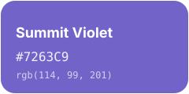 | 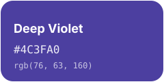 | 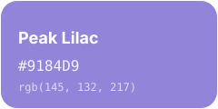 | 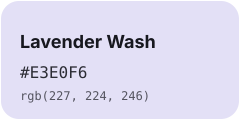 |
| 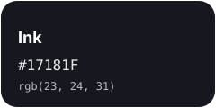 | 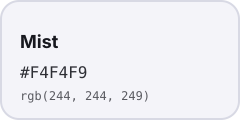 | 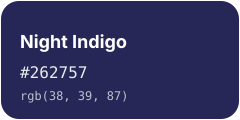 | 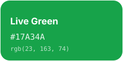 |

| 🔒 Private tools: *Tide* | | | |
|:---:|:---:|:---:|:---:|
| 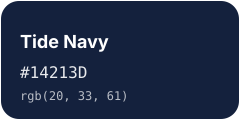 | 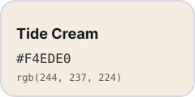 | 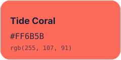 | 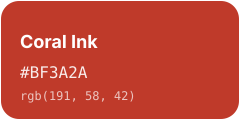 |

| | |
|---|---|
| 🔺 **Logo** | The *Summit*: two strokes and a lilac peak dot, in [`logo/`](logo/) (`summit-light.svg`, `summit-dark.svg`, `summit-mono-white.svg`, app marks) |
| 🔤 **Type** | Inter on the public site, Cairo for Arabic, Bricolage Grotesque over Quicksand in the tools |
| 💬 **Tagline** | *"Tracks, not courses."* Plain, direct, kind, a little funny |
| 🌈 **Signature gradient** | `linear-gradient(110deg, #7263C9, #4C3FA0)` |

> [!IMPORTANT]
> In the tools, text on Coral is always **Navy** (white on Coral fails contrast). Coral as text on Cream steps down to **Coral Ink**.

<p align="center"></p>

## 🚧 12. Known limits and roadmap

These come from the code and from [`docs/ARCHITECTURE.md`](docs/ARCHITECTURE.md):

- **Function ceiling.** New server features must be folded into one of the 12 existing functions.
- **Reminder emails are built but off.** To turn them on:
  1. Set `MEETING_REMINDERS=on`.
  2. Copy [`docs/meeting-reminders.yml`](docs/meeting-reminders.yml) to `.github/workflows/`.

  The Hobby plan's cron runs at most once a day, which is why the clock lives in GitHub Actions. GitHub can start scheduled runs late, and it switches a schedule off after 60 days without a commit.
- **Google Calendar push from `/time` is inactive** until an OAuth client ID is configured. Until then it falls back to `.ics` import.
- **No offline support.** No page has a service worker. Floosy installs to the home screen but needs the network.
- **Files live in Postgres.** Request bodies cap single uploads at about 3 MB. Only session files go larger (up to 20 MB, in chunks).
- **Meeting series** stop at 60 sessions. They do not grow when more hours are bought later; schedule another series from where the last one ended.
- **CMS overrides are keyed by original content.** Changing the source text of an element orphans its override, and the page falls back to the source. `DELETE /api/cms?all=1` clears old overrides.
- **Goal history before goal logging began is estimated.** It is marked `estimated`, drawn dashed, and removable.
- **The Floosy agent needs Claude.** Without an Anthropic key, only the council, chat and intent work, using Gemini.


---

📚 **Further reading:** [`docs/ARCHITECTURE.md`](docs/ARCHITECTURE.md) covers the content overlay internals, the hours and meeting engines, the plan page, the video hub and the newsletter in more depth.

<p align="center"><b>Tracks, not courses. 🏔 Built with one passkey, twelve functions and zero build steps. If a button does nothing, check <code>elementFromPoint</code> first. 😉</b></p>

<p align="center"></p>
