

<h1 align="center">🎨 The ahmedtarek.tech Brand Book</h1>

<b>One summit, two moods:</b> calm violet on the public site 💜, warm navy and coral in the private tools 🧡 
Every value on this page is read from the code: CSS tokens, logo files and real page copy.


## 🗂 Contents

- [🏔 Brand story and personality](#-brand-story-and-personality)
- [🔺 Logo: the Summit](#-logo-the-summit)
- [🎨 Colour palette](#-colour-palette)
- [🔤 Typography](#-typography)
- [💬 Voice and tone](#-voice-and-tone)
- [🧩 UI elements](#-ui-elements)
- [😀 Iconography and emoji](#-iconography-and-emoji)
- [✅ Do and ❌ don't](#-do-and--dont)
- [📁 Where the brand lives in code](#-where-the-brand-lives-in-code)

---

## 🏔 Brand story and personality

The whole brand grows out of one line that appears all over the public site:

> ### "Tracks, not courses."

The owner's view is that people do not fail because they lack effort; they fail because they lack a path. So the brand is about **getting from where you are to the top, one clear step at a time**. That idea shows up in many places:

- 🔺 The logo is a **summit**, with a dot at the peak.
- 📰 The newsletter is called **The Track**.
- 🪜 The method section has six numbered steps on a curving path.
- 🛠 Each private tool turns a vague goal into a next step: a fix-day queue, a focus block, a money split.

**Personality.**

| 🎭 Trait | What it means on the page |
|---|---|
| 🧭 **Clear** | Short sentences, numbered steps, one action per screen |
| 🤝 **Honest** | No hype. "If I am not, I will say so." Numbers come from real data |
| 🎓 **Teacherly** | Explains the *why* in plain words, in pop-overs, wizards and code comments |
| 😄 **Warm and a bit playful** | Confetti at 100%, jokes when you tick a task, a shark that talks money |
| 🛡 **Careful** | Privacy first, confirm before saving, passkeys rather than passwords |

**Two moods, one family.**

| | 🌐 Public: *Summit* | 🔒 Private tools: *Tide* |
|---|---|---|
| Where | `/`, `/product`, `/educator`, `/full`, share page | `/admin`, `/time`, `/desk`, `/dashboard`, `/security` |
| Feeling | Calm, premium, credible | Friendly, bouncy, cosy |
| Ground | White and Mist, with Night Indigo bands | Navy by night, Cream by day |
| Accent | Summit Violet | Tide Coral |
| Type | Inter | Bricolage Grotesque over Quicksand |

---

## 🔺 Logo: the Summit

A mountain drawn as two strokes, with a lilac dot at the peak. The left stroke (the climb) is solid. The right stroke (the way still to go) is softer.

| Light backgrounds | Dark backgrounds | One colour, on any brand fill |
|:---:|:---:|:---:|
| 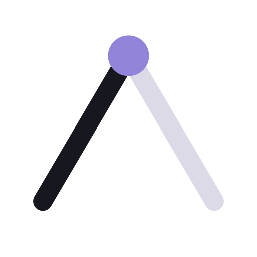 | 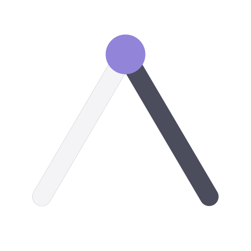 | ⬜ <i>white mark: invisible on a white page, see it on Ink in the site header</i> |
| [`logo/summit-light.svg`](../logo/summit-light.svg) | [`logo/summit-dark.svg`](../logo/summit-dark.svg) | [`logo/summit-mono-white.svg`](../logo/summit-mono-white.svg) |

| App and favicon marks | |
|:---:|---|
| 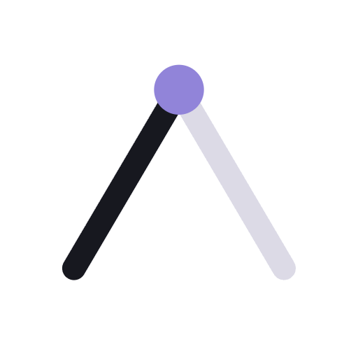 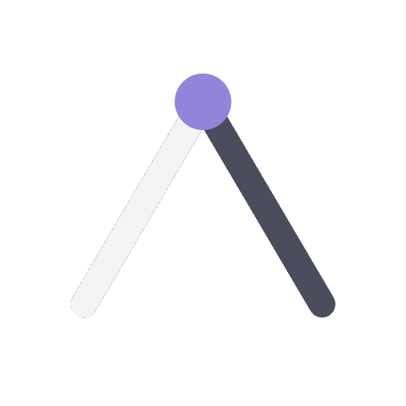 | [`logo/mark-512-transparent.png`](../logo/mark-512-transparent.png), [`logo/mark-512-dark-bg.png`](../logo/mark-512-dark-bg.png), plus `favicon-32/64/180.png` and `icon-96/144/192/512.png` in [`logo/`](../logo/) |

**Construction** (from the SVG source, on a 120 × 120 grid):

- **Strokes:** two of them, each 9 units wide with round caps and round joins.
- **Shape:** the peak is at (60, 26) and the feet are at (20, 94) and (100, 94).
- **Peak dot:** radius 9.5, in Peak Lilac `#9184D9`.
- **Light version:** the climb is Ink `#17181F` and the far side is `#DCDAE6`.
- **Dark version:** the climb is `#F4F4F7` and the far side is `#4B4C5C`.

**Clear space.** In the site header the 20 px mark sits inside a 34 px Ink tile with 8 px rounded corners. Keep at least that much space, about one third of the mark's width, on every side.

> [!TIP]
> On a busy or coloured background, use the white one-colour mark inside an Ink tile, exactly as the site's header does.

> [!WARNING]
> `/logo` is served as immutable for a year. If you change a logo file, **give it a new filename**, or browsers and link scrapers will keep the old one.

---

## 🎨 Colour palette

### 🌐 Summit: the public site

Source: `:root` tokens in [`index.html`](../index.html) and [`css/site/journey.css`](../css/site/journey.css).

| Swatch | Name | HEX | RGB | Used for |
|---|---|---|---|---|
| 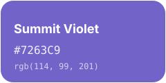 | **Summit Violet** | `#7263C9` | 114, 99, 201 | The brand accent (`--color-accent`, `--blue`): links, key words, outline buttons, timeline dots, the start of the gradient |
| 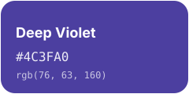 | **Deep Violet** | `#4C3FA0` | 76, 63, 160 | The end of the brand gradient (`--grad`), strong accent shades |
| 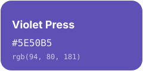 | **Violet Press** | `#5E50B5` | 94, 80, 181 | Hover and pressed accent (`--blue-2`), filled buttons |
| 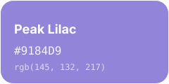 | **Peak Lilac** | `#9184D9` | 145, 132, 217 | The logo's peak dot, soft highlights |
| 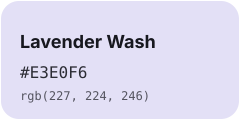 | **Lavender Wash** | `#E3E0F6` | 227, 224, 246 | Tinted section backgrounds (`--color-section`) |
| 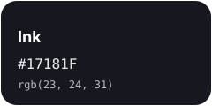 | **Ink** | `#17181F` | 23, 24, 31 | Body text, dark buttons, the logo tile |
| 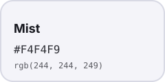 | **Mist** | `#F4F4F9` | 244, 244, 249 | Secondary background (`--bg-2`), logo strips |
| 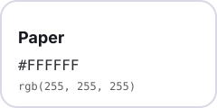 | **Paper** | `#FFFFFF` | 255, 255, 255 | The main page ground |
| 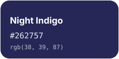 | **Night Indigo** | `#262757` | 38, 39, 87 | Start of the dark band gradient (testimonials, footer) |
| 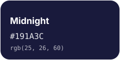 | **Midnight** | `#191A3C` | 25, 26, 60 | End of the dark band gradient |
| 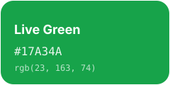 | **Live Green** | `#17A34A` | 23, 163, 74 | "Open to work" and live status dots (`--live`) |

**Signature gradient:** `linear-gradient(110deg, #7263C9 0%, #4C3FA0 100%)`.
**Night band:** `linear-gradient(140deg, #262757, #191A3C)` with text in `#E9E9ED`.

### 🔒 Tide: the private tools

Source: [`css/tools/tide.css`](../css/tools/tide.css). In the file's own words: *"Three colours and nothing else carries the brand."*

| Swatch | Name | HEX | RGB | Used for |
|---|---|---|---|---|
| 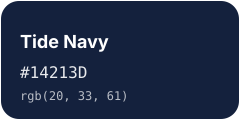 | **Tide Navy** | `#14213D` | 20, 33, 61 | The ground by night, the ink by day |
| 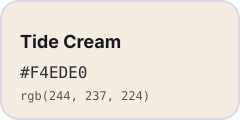 | **Tide Cream** | `#F4EDE0` | 244, 237, 224 | The ink by night, the ground by day |
| 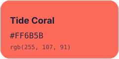 | **Tide Coral** | `#FF6B5B` | 255, 107, 91 | The single accent: buttons, the active tab, focus rings, chart lines |
| 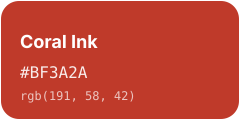 | **Coral Ink** | `#BF3A2A` | 191, 58, 42 | Coral used *as text* on Cream (4.7:1 contrast) |

> [!IMPORTANT]
> **Contrast rules (from `tide.css`):** white text on Coral is only 2.9:1, so anything written on Coral is **Navy** (5.9:1). When Coral is used as text on Cream, it steps down to **Coral Ink**. Status colours (green, amber, red) and chart series colours are *not* brand colours.

---

## 🔤 Typography

| Family | Where | Weights loaded | Role |
|---|---|---|---|
| **Inter** | Public site (`--font-heading`, `--font-body`) | 400 · 500 · 600 · 700 · 800 | Headings use weight **500** with slightly tight tracking; body text is 400 |
| **Cairo** | Arabic text everywhere; the main face of Floosy | 400 · 500 · 600 · 700 | Right-to-left screens |
| **Bricolage Grotesque** | Private tools, display (`--font-display`) | as loaded per page | Headings and big numbers |
| **Quicksand** | Private tools, interface (`--font-ui`) | as loaded per page | Buttons, labels, body |

**Type scale on the public site** (from `index.html` and `journey.css`):

| Step | Size | Example |
|---|---|---|
| Display | `clamp(2.7rem, 10.5vw, 7.4rem)` | The hero name on `/product` |
| H1 / section hero | `clamp(2.4rem, 8vw, 5rem)` · `clamp(2rem, 6vw, 3.6rem)` | "Let's build something great." |
| H2 | 40 px, line-height 1.08, tracking −0.015em | "Subscribe to The Track" |
| H3 | 30 px, line-height 1.2 | "Learn on a Track" |
| Quote / lead | 21 px, line-height 1.35 | "Tracks, not courses." |
| Card title | 18 px | "Track-builder checklist" |
| Body | 14–15 px · 1rem | Paragraphs and cards |
| Eyebrow | 0.72–0.78 rem, uppercase, wide tracking, numbered | `01 —— CONTENT HUB` |

---

## 💬 Voice and tone

**Plain, direct, kind, and a little funny.** Write the way a good teacher talks to one person.

| ✅ Sounds like us (real copy) | Why it works |
|---|---|
| "Tracks, not courses." | Three words, one idea, easy to remember |
| "Watching videos won't change your life. A track will." | Names the problem, then promises a way out |
| "Learning is a product problem." | Bridges the two halves of the brand: teaching and building |
| "Thirty minutes, no pitch. Tell me what you're building or where you're stuck." | Low pressure, specific, human |
| "Not on a download page yet — ask me and I will send them over." | Honest about what is not finished yet |
| "Unsubscribe any time, no hard feelings." | Friendly, never needy |
| "If I am not, I will say so." | Trust before the sale |

**In the private tools** the voice gets warmer and more playful:

- 🎉 Short jokes and celebrations when a task is ticked or a day reaches 100%.
- 🦈 Floosy's Shark speaks Egyptian colloquial Arabic, or plain English.
- 🧾 Rules are spelled out in everyday words, for example "fix today: it stops payment, sign-in, or loses data".

**Code comments are part of the voice:** they explain the *why*, never restate the code (see the README's Conventions).

**Avoid:** buzzwords, hype ("revolutionary", "10x"), guilt-tripping, and walls of text.

---

## 🧩 UI elements

| Element | Public (Summit) | Private tools (Tide) |
|---|---|---|
| **Corner radius** | `4 / 8 / 14 px` (`--radius-sm/md/lg`), pills for chips and CTAs | `8 / 12 / 16 / 24 px` (`--radius-sm…xl`), pill buttons |
| **Buttons** | Primary: Violet fill, white text, pill. Secondary: white with a violet outline, pill. Dark: Ink fill | Coral fill with **Navy** text, pill, a bouncy press |
| **Cards** | White or warm-off-white surfaces, thin borders, generous padding, an arrow link at the bottom ("See my experience →") | Glass surfaces (`--glass`) with `--shadow-card`; tickets and clay-3D cards in `/time` and `/desk` |
| **Shadows** | Light and subtle on white; outlined rings on the dark design system (`--shadow-sm/md/lg`) | Night: `0 12px 32px rgba(6,12,28,.45)`. Day: `0 8px 24px rgba(20,33,61,.07)` |
| **Motion** | `cubic-bezier(.2,.8,.2,1)` at 0.35–0.4 s; scroll reveals; count-ups; a drawn timeline | `--ease-bounce: cubic-bezier(0.34,1.56,0.64,1)`, `--ease-out: cubic-bezier(0.22,1,0.36,1)`; confetti, ripples, tilt |
| **Texture** | Soft radial glows, an "aurora" background on the journey pages | Fine vertical "flute" lines plus a coral glow in the hero (`--ground`, `--hero`) |

> [!NOTE]
> All animation respects `prefers-reduced-motion`. The motion is there to give feedback, never to block the user.

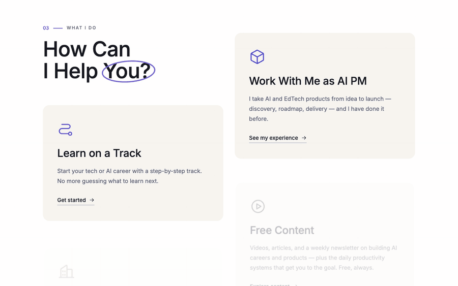

The Summit style live: violet timeline, calm type, soft cards (public home page).

---

## 😀 Iconography and emoji

- **Public site:** Phosphor-style line icons, drawn as **CSS masks** in [`css/site/icons.css`](../css/site/icons.css), coloured with the accent. A filled pill behind a masked icon needs a second element.
- **Private tools:** one shared SVG set in [`js/tools/icons.js`](../js/tools/icons.js), plus emoji used as friendly signposts: 🔁 repeating events, 🧠 plan my day, 🌙 end of day, 🍅 focus rounds, 🦈 the Shark, 🎛 controls, 📥 / 📤 import and export.
- **Emoji rules:** one emoji per label, as a signpost and never as decoration in the middle of a sentence. Always pair it with a word.

---

## ✅ Do and ❌ don't

| ✅ Do | ❌ Don't |
|---|---|
| Use Summit Violet for the *one* thing that matters on a screen | Put violet and coral side by side as equal accents on the same page |
| Put Navy text on Coral | Put white text on Coral (2.9:1 fails contrast) |
| Use the logo's own files, with the one-colour mark on an Ink tile over busy backgrounds | Recolour, stretch, rotate, outline or add a shadow to the Summit |
| Keep headings at weight 500 with tight tracking | Use bold-everything headings or all caps outside eyebrows |
| Write one idea per sentence, with numbers that come from real data | Invent stats or use hype words |
| Animate with the brand easings, and respect reduced motion | Add motion that delays a click or loops forever in the content |
| Rename an asset file when you change it (`/logo` and `/assets` are cached for a year) | Replace a cached image in place |

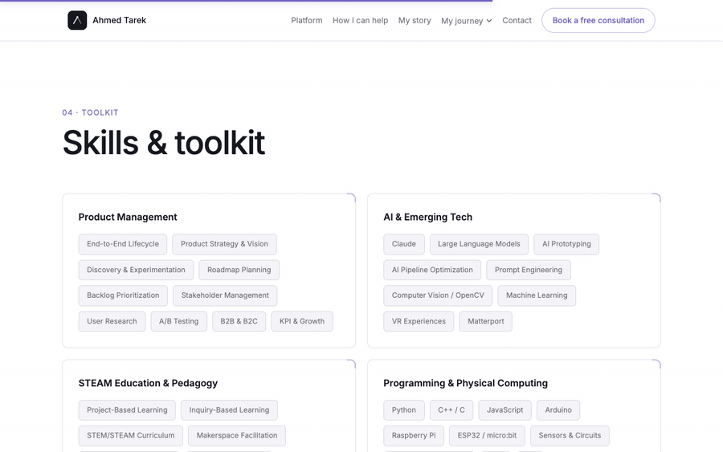

Chips, cards and the violet display headline on <code>/product</code>.

---

## 📁 Where the brand lives in code

| What | File |
|---|---|
| Public design tokens (home) | `:root` block in [`index.html`](../index.html), on top of [`_ds/…/styles.css`](../_ds/) |
| Public tokens (journey pages) | [`css/site/journey.css`](../css/site/journey.css) |
| Tools palette (Tide) | [`css/tools/tide.css`](../css/tools/tide.css), loaded **last** on every tool page |
| Tools house style, radii, easings, fonts | [`css/tools/go.css`](../css/tools/go.css) |
| Logo and app icons | [`logo/`](../logo/) |
| Floosy app icons | [`finance/icon-*.png`](../finance/) |
| These brand assets | [`branding/assets/`](assets/) (colour swatches, animated hero, animated divider, GIFs) |

<b>One summit. One next step. 🏔</b>

